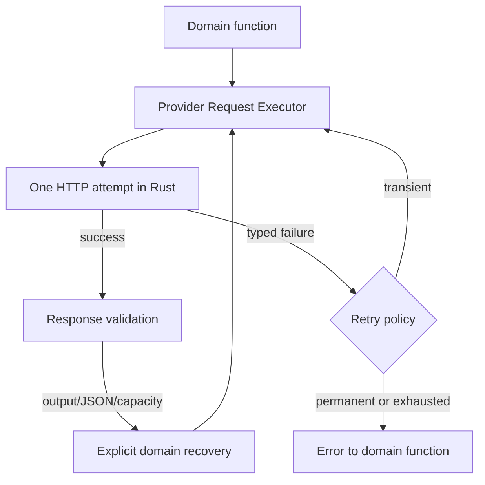

# Unified Provider Retry Architecture — Final Design

**Scope:** AI RV Harness — public v0.7.12 and private v0.7.13 test baseline  
**Status:** `COMPLETED` — implementation and closing audit completed on 2026-09-04

> Closeout update: the full contract matrix, cancellation behavior, protection against duplicate writes, and Rust/Tauri CI were confirmed. Details: `docs/reports/PROVIDER_TRANSPORT_RETRY_CLOSURE_AUDIT_v0.7.13_PL.md`.

**Purpose:** provide one consistent handling path for transient provider failures across all inference calls, without nested retries and without duplicating session data.

## Audit state — 2026-09-02

The first hardening pass after implementation was completed in the private v0.7.13 baseline:

- removed unused `shouldRetryProviderError` and `waitBeforeProviderRetry` helpers;
- removed ineffective `activeLogicalRequests` protection that checked a newly generated identifier;
- retained the working branded-executor protection against directly wrapping an executor in a second executor;
- added an automated import-boundary test allowing `providerChatAttempt` only in `native.ts` and `requestExecutor.ts`;
- after the change, typecheck, 79 test files / 231 tests, and the production build passed.

At that point, full audit closure still required contract matrices for every call family, integration tests for cancellation and duplicate-write prevention, and Rust/Tauri CI. Those items were subsequently completed as recorded by the status above.

## 1. Decision summary

Introduce a single shared provider-request executor in the TypeScript layer, for example `src/providers/requestExecutor.ts`. Only this executor may retry the same physical request after a transport failure or transient service failure.

The Rust layer must perform exactly one HTTP attempt and return a structured error. Session controllers must no longer contain their own transport-retry loops. They may run only explicitly named recovery operations that change the request, such as increasing output budget, repairing JSON, or performing the second Viewer Notes capacity attempt.

This solution covers:

- Conversation and Manual RV;
- Automatic RV, RV Lite, Custom, and Telepathic;
- Viewer, AI Monitor, and Special Tasks;
- automatic and manual post-Reveal analysis;
- post-Reveal Monitor evaluation;
- AI Judge;
- Viewer Notes reflection;
- Training and Research;
- resuming an interrupted session.

Model-list discovery and connection testing are outside this scope because they are configuration operations, not inference calls.

## 2. What inspection of the existing code showed

### 2.1. Origin of the investigated failure

In `src-tauri/src/providers.rs`, `json_response()` calls `response.text().await`. The message:

```text
provider response body read failed: error decoding response body
```

means that an HTTP response began, but the client failed to completely read or decode the body. `reqwest` exposes separate `is_body()` and `is_decode()` classifiers, so this can be represented as a typed failure without matching English message text. It is a transport/read failure, not a prompt, Reveal, Judge-schema, or Viewer Notes capacity failure.

### 2.2. Retry was distributed across multiple layers

| Area | Previous behavior |
| --- | --- |
| Full RCP / Automatic RV | controller-owned retry loops |
| RV Lite | controller-owned retry loops |
| Custom | controller-owned retry loop |
| Telepathic and resume | controller-owned retry loops |
| AI Monitor during a session | no own retry; depended on the controller loop |
| post-Reveal Viewer / Monitor | output-exhaustion recovery only; no transport retry |
| AI Judge | output recovery and domain JSON repair only; no transport retry |
| Viewer Notes | output recovery, JSON repair, and capacity retry; no transport retry |
| Conversation / Manual RV | no automatic retry; later manual retry available |

`maxRetries` reached the main session controllers but was not propagated to every post-Reveal, Judge, and Viewer Notes stage. As a result, the same provider failure was handled differently depending on where it occurred.

### 2.3. Existing classification mixed different recovery types

`src/providers/retry.ts` previously classified both transport failures and `reasoning without a final assistant response` / truncated output as `single_recovery`. At the same time, `src/providers/outputRecovery.ts` had its own attempt for truncated output.

Adding shared retry without separating these categories could cause one failure to be repeated by both layers. That must be prevented.

### 2.4. Why retry should not live in Rust

The Rust layer does not know the full operation context:

- user `maxRetries` setting;
- session-stage boundaries and resume rules;
- event audit and attempt numbering;
- cost guard;
- distinction between transport retry and output/JSON recovery.

If Rust retried internally while a controller kept its own loop, attempts would multiply. Rust should therefore perform one request and precisely describe the result or failure; a single shared TypeScript executor owns retry decisions.

## 3. Lessons from other projects and documentation

1. AWS describes the classic multi-layer retry problem: three retries at five layers can amplify load on the lowest service by 243 times. The recommendation is to retry in one place and use backoff with jitter.  
   Source: [AWS Builders’ Library — Timeouts, retries, and backoff with jitter](https://aws.amazon.com/builders-library/timeouts-retries-and-backoff-with-jitter/).

2. Microsoft likewise recommends avoiding duplicated/cascading retry layers and bounding both attempt count and retry duration.  
   Sources: [Azure — Transient fault handling](https://learn.microsoft.com/en-us/azure/architecture/best-practices/transient-faults), [Azure — Retry Storm antipattern](https://learn.microsoft.com/en-us/azure/architecture/antipatterns/retry-storm/).

3. Official OpenAI SDKs centralize retry in the client. By default they retry transient connection failures and HTTP 408, 409, 429, and 5xx with short exponential backoff; retry can be configured per client or request.  
   Source: [OpenAI Node — Client configuration, retries and timeouts](https://github.com/openai/openai-node/blob/main/docs/configuration.md).

4. Vercel AI SDK exposes one `maxRetries` setting for generation operations, defaulting to 2. This supports having one execution point instead of loops scattered through domain functions.  
   Source: [AI SDK Core — generateText](https://ai-sdk.dev/docs/reference/ai-sdk-core/generate-text).

5. The open-source `p-retry` library separates execution, `shouldRetry`, retry-budget consumption, error callbacks, backoff, and cancellation. That split is a useful API model for the Harness executor, but adding the dependency is unnecessary because the Harness requires its own audit and cost guard.  
   Source: [sindresorhus/p-retry](https://github.com/sindresorhus/p-retry).

6. OpenRouter exposes stable `error_type` values and recommends classification from them rather than HTTP status alone. `rate_limit_exceeded` requires honoring `Retry-After`, while `provider_overloaded`, `provider_unavailable`, and `timeout` are transient. OpenRouter itself may perform provider fallback for the same model when it can do so before the response begins. Once a response has started, a broken connection can still reach the client.  
   Sources: [OpenRouter — Error handling and debugging](https://openrouter.ai/docs/api_reference/errors-and-debugging), [OpenRouter — Provider routing](https://openrouter.ai/docs/guides/routing/provider-selection), [OpenRouter — Rate limits](https://openrouter.ai/docs/api_reference/limits).

7. Google recommends retrying only when both the error type and the safety of repeating the operation permit it; it recommends exponential backoff with jitter and warns against layering application retry on top of client retry.  
   Source: [Google Cloud — Retry strategy](https://docs.cloud.google.com/storage/docs/retry-strategy).

## 4. Target architecture



### 4.1. Rust: one attempt and a typed error

`provider_chat` does not receive a retry loop. Instead of a text-only error, it returns a serializable object, for example:

```ts
type ProviderCallError = {
  code:
    | "connect"
    | "timeout"
    | "request_send"
    | "response_body_read"
    | "response_body_decode"
    | "invalid_provider_json"
    | "http_status"
    | "cancelled"
    | "configuration";
  message: string;
  httpStatus?: number;
  providerErrorType?: string;
  providerCode?: string;
  retryAfterMs?: number;
  providerRequestId?: string;
  phase: "before_dispatch" | "awaiting_headers" | "reading_body" | "parsing_body";
};
```

Use `reqwest::Error::is_connect()`, `is_timeout()`, `is_body()`, and `is_decode()`. The message remains human-readable, but retry decisions do not depend on matching English substrings. For compatibility, a parser for legacy string errors may remain as a fallback for one release cycle.

The response identifier should be collected from headers before reading the body and included in body-read failures. This makes diagnosis with OpenRouter or another provider easier.

### 4.2. TypeScript: one `executeProviderRequest()`

The new executor is the sole owner of transport retry. It receives:

- an exact, immutable request;
- `configuredRetries` from settings;
- `AbortSignal`;
- `operationId`, stage name, and role (`viewer`, `monitor`, `judge`, `notes`);
- `beforeAttempt`, `onAttemptSuccess`, and `onAttemptFailure` callbacks;
- optional cost-guard and metrics integration.

It returns the response plus an attempt report:

```ts
type ProviderExecutionResult = {
  response: ProviderChatResponse;
  logicalRequestId: string;
  physicalAttempts: number;
  recoveredFrom?: ProviderFailureClass;
};
```

Each physical attempt has its own `requestId`, but all attempts of the same payload share one `logicalRequestId` and request hash. The executor verifies that a retry sends the identical model, messages, and settings.

### 4.3. Three disjoint mechanisms

| Mechanism | Owner | Does payload change? | Example |
| --- | --- | --- | --- |
| Transport retry | `requestExecutor` | no | body decode, reset, 429, 503 |
| Output recovery | `outputRecovery` | yes | 8192 → 16384 tokens |
| Domain recovery | Judge / Notes / domain parser | yes | JSON repair, capacity retry |

`outputRecovery` must not classify network failures. The executor must not classify `finish_reason=length`, invalid Judge schema, or Notes-capacity overflow as transport failures.

A new repair prompt is a new logical request, so it may have its own single transport protection. This is not accidental nesting: the log records, for example, `semanticAttempt=json_repair`, and all physical attempts are counted. At the operation level, an explicit recovery plan defines what is allowed; there is no generic `while` loop or recursion.

### 4.4. Protection against nested retry returning later

Apply four safeguards:

1. remove transport loops from session controllers;
2. do not export low-level `nativeProviderChat` outside the provider module; the rest of the application imports the executor;
3. add a `RetryContext`/ledger containing `operationId`, `logicalRequestId`, physical attempt number, and recovery name;
4. add a test that intentionally combines transport failure with output recovery and verifies the exact number of calls.

In development mode, the executor should reject attempts to start while a retry context for the same `logicalRequestId` is active. This detects future accidental wrapping of the executor in another retry loop.

## 5. Final retry policy

`maxRetries` continues to mean retries after the first call. A value of `0` disables automatic retry according to the user's explicit choice. The default remains `2`.

| Failure | Policy |
| --- | --- |
| DNS/connect/TLS/send before receiving a response | up to `maxRetries` |
| HTTP 408, 425, 429, 500, 502, 503, 504 | up to `maxRetries` |
| OpenRouter `rate_limit_exceeded`, `provider_overloaded`, `provider_unavailable`, `timeout`, `server` | up to `maxRetries` |
| `response_body_read`, `response_body_decode`, unexpected EOF, reset/close while reading body | at most 1 retry, even if configured higher |
| invalid JSON for the provider response as a whole | at most 1 retry; treated as a corrupted transport/provider payload |
| empty assistant response without a safety block | at most 1 retry |
| `finish_reason=length`, reasoning without a final response | no transport retry; one output recovery with a larger budget |
| invalid Judge/Notes JSON after a correctly read response | no transport retry; at most one explicit JSON repair |
| Viewer Notes capacity overflow | no transport retry; second and final capacity attempt under the existing design |
| 400, 401, 402, 403, 404, 422; bad model; bad parameter; context length; safety/refusal | never automatically |
| user cancellation, cost limit, route mismatch | never automatically |

The Harness must not automatically switch models. A model change would break Viewer identity, Research comparability, Session Snapshot, and Viewer Notes semantics. OpenRouter may perform provider fallback for the same model under its own configuration, but the Harness should not switch to a different model on its own.

## 6. Backoff, `Retry-After`, and time limits

1. If a response contains a valid `Retry-After`, wait at least that long, capped at 30 seconds.
2. Without the header, use capped exponential backoff with full jitter:
   - base 500 ms;
   - cap 8 s;
   - randomly choose a delay within the bounded range for each attempt.
3. A single ambiguous body/decode recovery should use a short backoff of roughly 500–1000 ms.
4. `AbortSignal` cancels both the active request and the wait between attempts.
5. Each attempt keeps the existing per-request timeout. Operation reporting shows total duration across all attempts.

The previous 150/300/600 ms backoff without jitter should be replaced. During overload, overly fast synchronized retries can make the situation worse.

## 7. Cost and ambiguity of retrying POST

After a body-read failure, the client cannot know with certainty whether the model generated a response or the provider billed the request. Therefore:

- such a failure gets at most one automatic retry;
- the audit marks the first attempt as `billingStatus: unknown`;
- Session Cost Guard conservatively reserves the upper bound for the failed attempt; the existing `CostAuthorization.failure()` behavior already reserves maximum cost and must not be weakened;
- technical UI details may say “recovered after ambiguous provider response; previous attempt may have been billed”;
- metrics should distinguish `logicalRequestCount`, `physicalAttemptCount`, and `ambiguousBillingAttemptCount`.

This matters especially in Training, where many targets run sequentially.

## 8. Persistence and resume rules

- A user message or controller step is persisted once before entering the executor.
- Failed physical attempts persist only a technical event; they do not append another transcript message.
- The assistant response is persisted only after a complete accepted body is received.
- Monitor retry does not repeat earlier Viewer work.
- Post-Reveal retry does not append the same question twice.
- Judge retry does not freeze a partial result; the existing rule of freezing the complete valid group remains.
- Viewer Notes retry does not create a version before validation and atomic commit.
- Interruption after retries are exhausted preserves the session and existing checkpoints; existing Resume starts at the first missing logical request.

## 9. Code-change plan

### Stage A — typed errors

- add a serializable error type in `src-tauri/src/providers.rs`;
- preserve request ID, status, `Retry-After`, and OpenRouter `error_type`;
- distinguish body read/decode failure from JSON parsing failure;
- normalize the object in `src/providers/native.ts`.

### Stage B — shared executor

- create `src/providers/requestExecutor.ts`;
- move classification, attempt limits, backoff, jitter, cancellation, and attempt reporting into it;
- rebuild `src/providers/retry.ts` as a typed policy without domain failures;
- keep the legacy string parser only as a compatibility fallback.

### Stage C — consumer migration

- replace direct `nativeProviderChat` calls with the executor;
- remove retry loops from RCP, Lite, Custom, and Telepathic;
- migrate Monitor, Conversation/Manual RV, post-Reveal, Judge, and Viewer Notes;
- propagate `settings.maxRetries`, timeout, and signal to post-Reveal, Judge, and Notes as well;
- retain audit, metrics, and cost-guard callbacks at the individual physical-attempt level.

### Stage D — tests and documentation

- unit tests for policy and executor;
- contract tests for all call families;
- exact physical-attempt count tests;
- Resume and duplicate-write prevention tests;
- documentation updates for retry settings and UI messages.

## 10. Required acceptance tests

1. Body decode in Automatic RV: 2 physical attempts, 1 persisted response.
2. Body decode in Reveal Viewer review: 2 attempts, 1 persisted question and 1 response.
3. The same for Monitor review, Judge, Notes, Conversation, and Manual RV.
4. `maxRetries=0`: exactly 1 physical attempt.
5. `maxRetries=5` + body decode: still at most 2 physical attempts.
6. `503` twice, then success with `maxRetries=2`: exactly 3 attempts.
7. `401`, safety, context length, and cost limit: exactly 1 attempt.
8. `Retry-After`: next attempt does not begin before the indicated time.
9. Cancellation during backoff: no subsequent call.
10. Truncated output followed by success with a larger budget: 2 logical requests, no transport retry.
11. Body decode during the second output-recovery request: 3 physical attempts total, not 4 or 6.
12. Invalid Judge JSON: 1 judging request + 1 explicit JSON repair; each layer has its own described identifier.
13. Notes capacity retry receives complete session data and is not confused with transport retry.
14. Monitor retry does not repeat Viewer.
15. Resume after retry exhaustion replays stored responses and calls the provider only for the missing step.

Tests should include a shared table covering every public inference path. Adding a future path without the executor must cause an import-rule or test failure.

## 11. Complexity

**Assessment: medium-high, approximately 7/10.**

The retry loop itself is simple. The difficult part is safely removing multiple existing loops while preserving cost guard, metrics, autosave, and Resume, and separating transport retry from the three existing domain-recovery mechanisms.

This is not a redesign of the RV protocol or database. If existing repository interfaces remain stable, no SQLite migration should be needed. The change still touches central controllers and requires full regression across all session types.

## 12. Readiness criteria

The solution is ready when:

- no inference path imports `nativeProviderChat` directly outside the executor module;
- controller code contains no transport-retry loops;
- every failure has a type, retryability classification, and unambiguous owner;
- all paths honor one `maxRetries` setting;
- tests prove exact call counts and absence of duplicate data;
- `provider response body read failed: error decoding response body` is automatically retried once at any stage unless the user set `maxRetries=0`;
- after the second failure, the session is safely interrupted or leaves a manual retry/Resume path without losing previously persisted work.

## 13. Final recommendation

Do not add another local `try/catch` only around Reveal, and do not place retry directly in Rust. Perform one controlled refactor: typed Rust errors, one TypeScript retry executor, removal of transport loops from controllers, and explicit preservation of domain-recovery mechanisms.

This is larger than a quick patch for one error message, but it is the correct “once and properly” solution. It removes the cause of inconsistent behavior and ensures that future AI features inherit correct retry behavior without copying another local loop.
